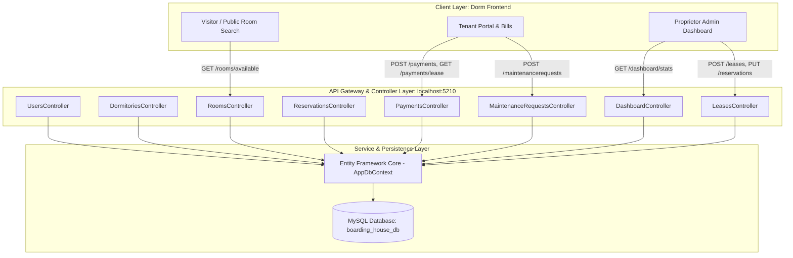
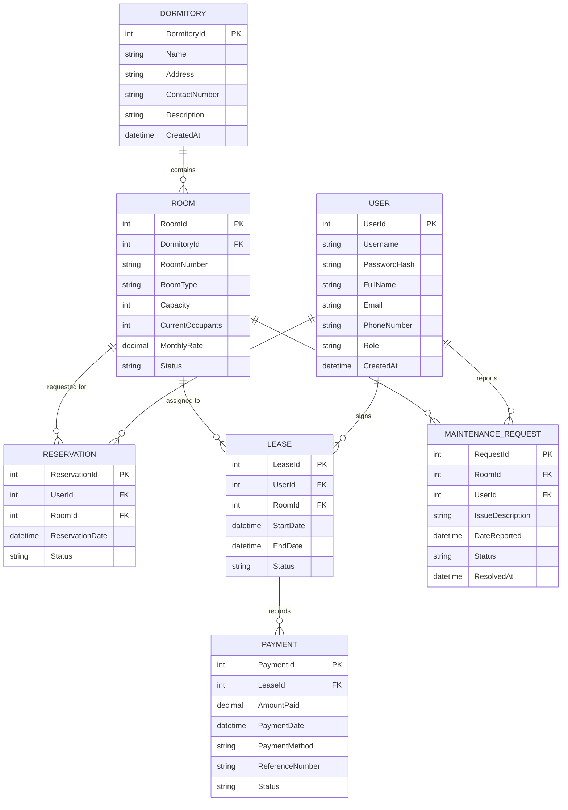
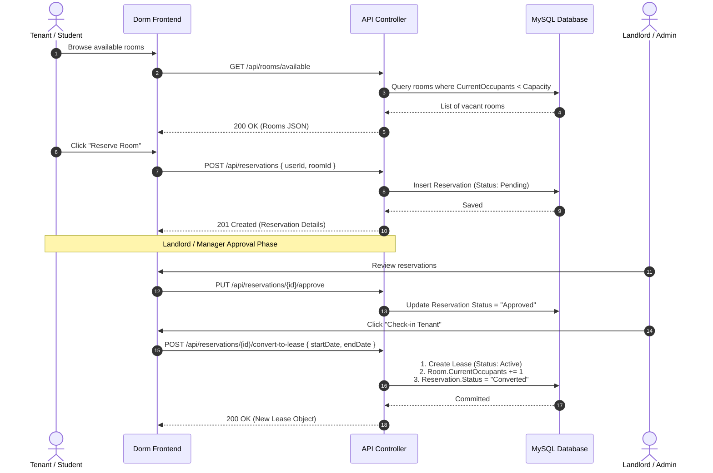
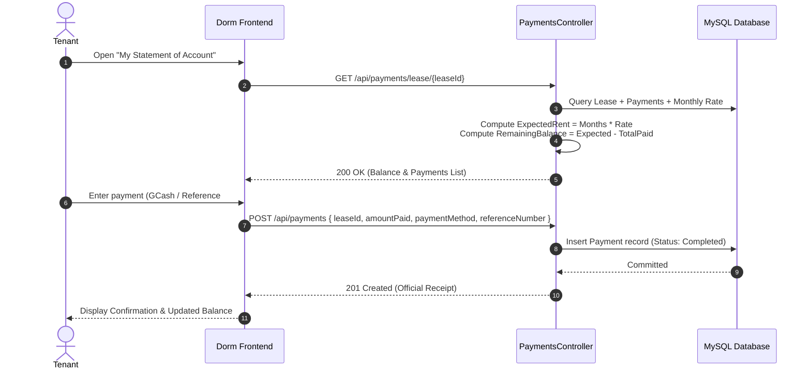

# Boarding House & Dormitory Management System
## Comprehensive API Design Specification & Frontend Integration Blueprint

**Target Frontend Project:** `Dorm` (Razor Pages / Web Client)  
**Target Backend Service:** `Boarding House Management System` (ASP.NET Core Web API)  
**Document Classification:** Masteral Project Architecture & Technical Specification  
**Default Base URL:** `http://localhost:5210/api`  
**API Version:** `v1`  
**Data Format:** `application/json; charset=utf-8`

---

## Table of Contents
1. [Executive Summary & System Architecture](#1-executive-summary--system-architecture)
2. [Data Model & Entity-Relationship Design](#2-data-model--entity-relationship-design)
3. [Global API Design Standards & Status Codes](#3-global-api-design-standards--status-codes)
4. [Complete Endpoint Catalog by Module](#4-complete-endpoint-catalog-by-module)
   - [Module 1: Authentication & User Accounts](#module-1-authentication--user-accounts)
   - [Module 2: Dormitories & Buildings](#module-2-dormitories--buildings)
   - [Module 3: Rooms & Availability](#module-3-rooms--availability)
   - [Module 4: Reservations & Booking Workflow](#module-4-reservations--booking-workflow)
   - [Module 5: Leases & Tenant Occupancy](#module-5-leases--tenant-occupancy)
   - [Module 6: Rent Payments & Financial Billing](#module-6-rent-payments--financial-billing)
   - [Module 7: Maintenance Requests & Repairs](#module-7-maintenance-requests--repairs)
   - [Module 8: Dashboard & Executive Analytics](#module-8-dashboard--executive-analytics)
   - [Module 9: Utility & Database Seeder](#module-9-utility--database-seeder)
5. [Frontend (Dorm) Integration & Page Mapping Matrix](#5-frontend-dorm-integration--page-mapping-matrix)
6. [Business Logic & Transactional Sequence Flows](#6-business-logic--transactional-sequence-flows)
7. [Frontend Implementation Blueprint (`Dorm` Client Code)](#7-frontend-implementation-blueprint-dorm-client-code)

---

## 1. Executive Summary & System Architecture

The **Boarding House Management System** provides a multi-tenant, RESTful API engine supporting the operational requirements of dormitory proprietors, staff administrators, and student/professional tenants.



### Core Architectural Attributes:
- **Stateless HTTP Protocol:** Standardized JSON over HTTP/HTTPS.
- **Cross-Origin Resource Sharing (CORS):** Enabled for frontend clients hosted on different ports (e.g., `http://localhost:5000` or custom domains).
- **Referential Integrity:** Enforced via relational database constraints with cascading payment deletions on lease removal, and restricted deletions on active occupancies.

---

## 2. Data Model & Entity-Relationship Design

The database schema connects dormitories, rooms, users, reservations, leases, payments, and maintenance requests:



---

## 3. Global API Design Standards & Status Codes

### Standard HTTP Status Codes

| Code | Status | Usage |
| :--- | :--- | :--- |
| **`200 OK`** | Success | Request succeeded and response contains the requested payload. |
| **`201 Created`** | Resource Created | New record successfully created; includes `Location` header to new ID. |
| **`204 No Content`** | Action Completed | Modification executed without body return. |
| **`400 Bad Request`** | Validation Error | Missing required fields, business rule violation (e.g. overcapacity). |
| **`401 Unauthorized`**| Auth Failure | Invalid username/password. |
| **`404 Not Found`** | Resource Missing | Entity ID does not exist in the database. |
| **`409 Conflict`** | Duplicate Key | Room number duplicate in dormitory, or username/email already registered. |
| **`500 Server Error`** | Unhandled Error | Internal database or unhandled application exception. |

### Standard Error Response Body
```json
{
  "message": "Human-readable error explanation",
  "errors": {
    "Field": ["Specific validation error description"]
  }
}
```

---

## 4. Complete Endpoint Catalog by Module

### Module 1: Authentication & User Accounts
Handles tenant, administrator, and landlord registrations and credentials.

#### 1.1 User Login
- **Method:** `POST`
- **Path:** `/api/users/login`
- **Purpose:** Authenticates user credentials and returns full user profile with roles.
- **Request Body:**
  ```json
  {
    "username": "john_doe",
    "password": "tenant123"
  }
  ```
- **Response `200 OK`:**
  ```json
  {
    "userId": 2,
    "username": "john_doe",
    "fullName": "John Doe",
    "email": "john.doe@email.com",
    "phoneNumber": "0918-333-4444",
    "role": "Tenant",
    "createdAt": "2026-05-12T00:00:00Z",
    "activeLeasesCount": 1
  }
  ```
- **Response `401 Unauthorized`:**
  ```json
  { "message": "Invalid username or password." }
  ```

#### 1.2 User Registration / Create Account
- **Method:** `POST`
- **Path:** `/api/users`
- **Purpose:** Register new Tenant or Admin with PBKDF2/SHA-256 secure password hashing.
- **Request Body:**
  ```json
  {
    "username": "student_anna",
    "password": "Password123!",
    "fullName": "Anna Marie Lopez",
    "email": "anna.lopez@university.edu",
    "phoneNumber": "0917-555-8888",
    "role": "Tenant"
  }
  ```
- **Response `201 Created`:** User profile object.

#### 1.3 Get All Users
- **Method:** `GET`
- **Path:** `/api/users`
- **Query Parameters:**
  - `role` (string, optional): e.g. `Tenant`, `Admin`, `Landlord`
  - `search` (string, optional): Search keyword against name, username, or email.
- **Response `200 OK`:** Array of `UserResponseDto`.

#### 1.4 Get User Profile with Complete History
- **Method:** `GET`
- **Path:** `/api/users/{id}`
- **Purpose:** Tenant or Admin profile retrieval including associated leases, reservations, and maintenance requests.
- **Response `200 OK`:** Detailed `UserDetailDto` object.

#### 1.5 Update Profile
- **Method:** `PUT`
- **Path:** `/api/users/{id}`
- **Request Body:**
  ```json
  {
    "fullName": "Anna Marie L. Santos",
    "email": "anna.santos@university.edu",
    "phoneNumber": "0917-555-9999",
    "role": "Tenant",
    "newPassword": "NewSecurePassword456!"
  }
  ```

#### 1.6 Delete User
- **Method:** `DELETE`
- **Path:** `/api/users/{id}`
- **Rule:** Rejects deletion if user currently has active leases.

---

### Module 2: Dormitories & Buildings
Manages dormitory building assets, location details, and aggregate capacity metrics.

#### 2.1 List All Dormitories
- **Method:** `GET`
- **Path:** `/api/dormitories`
- **Response `200 OK`:**
  ```json
  [
    {
      "dormitoryId": 1,
      "name": "Pinecrest Residence Hall",
      "address": "124 University Avenue, Metro District",
      "contactNumber": "0917-123-4567",
      "description": "Modern 3-story boarding house with Wi-Fi, 24/7 security, and CCTV.",
      "createdAt": "2026-04-12T00:00:00Z",
      "totalRooms": 10,
      "availableRooms": 6,
      "totalCapacity": 24,
      "currentOccupants": 9
    }
  ]
  ```

#### 2.2 Get Dormitory Details & Rooms
- **Method:** `GET`
- **Path:** `/api/dormitories/{id}`
- **Response `200 OK`:** Dormitory details including array of all rooms contained within.

#### 2.3 Create Dormitory Building
- **Method:** `POST`
- **Path:** `/api/dormitories`
- **Request Body:**
  ```json
  {
    "name": "Summit Heights Dorm",
    "address": "45 College Road, University District",
    "contactNumber": "0919-444-1234",
    "description": "Budget-friendly student residence with dedicated study lounges."
  }
  ```

#### 2.4 Update Dormitory
- **Method:** `PUT`
- **Path:** `/api/dormitories/{id}`

#### 2.5 Delete Dormitory
- **Method:** `DELETE`
- **Path:** `/api/dormitories/{id}`
- **Rule:** Rejects deletion if building contains active tenant leases.

---

### Module 3: Rooms & Availability
Room inventory management, real-time vacancy checking, and pricing.

#### 3.1 Get All Rooms (Filterable)
- **Method:** `GET`
- **Path:** `/api/rooms`
- **Query Parameters:**
  - `dormitoryId` (int, optional): Filter by building.
  - `status` (string, optional): `Available`, `Occupied`, `Maintenance`.
  - `roomType` (string, optional): e.g. `Single Private`, `Double Shared`, `Quad Dorm`.
  - `minRate` (decimal, optional): Minimum monthly price.
  - `maxRate` (decimal, optional): Maximum monthly price.
  - `search` (string, optional): Room number or keywords.

#### 3.2 View Available Rooms for Booking
- **Method:** `GET`
- **Path:** `/api/rooms/available`
- **Purpose:** Primary public endpoint used by `Dorm` frontend catalog to display only vacant units.
- **Query Parameters:**
  - `dormitoryId` (int, optional)
  - `roomType` (string, optional)
  - `maxRate` (decimal, optional)
- **Response `200 OK`:**
  ```json
  [
    {
      "roomId": 3,
      "dormitoryId": 1,
      "dormitoryName": "Pinecrest Residence Hall",
      "roomNumber": "Room 103",
      "roomType": "Double Shared",
      "capacity": 2,
      "currentOccupants": 1,
      "monthlyRate": 3200.00,
      "status": "Available"
    }
  ]
  ```

#### 3.3 Get Room by ID
- **Method:** `GET`
- **Path:** `/api/rooms/{id}`

#### 3.4 Create Room
- **Method:** `POST`
- **Path:** `/api/rooms`
- **Request Body:**
  ```json
  {
    "dormitoryId": 1,
    "roomNumber": "Room 204",
    "roomType": "Single Deluxe",
    "capacity": 1,
    "monthlyRate": 5500.00,
    "status": "Available"
  }
  ```

#### 3.5 Update Room
- **Method:** `PUT`
- **Path:** `/api/rooms/{id}`

#### 3.6 Quick Status Update
- **Method:** `PATCH`
- **Path:** `/api/rooms/{id}/status`
- **Request Body:**
  ```json
  { "status": "Maintenance" }
  ```

#### 3.7 Delete Room
- **Method:** `DELETE`
- **Path:** `/api/rooms/{id}`
- **Rule:** Disallowed if room is associated with active leases.

---

### Module 4: Reservations & Booking Workflow
Enables prospective tenants to reserve rooms online before moving in.

#### 4.1 Get All Reservations
- **Method:** `GET`
- **Path:** `/api/reservations`
- **Query Parameters:** `userId`, `roomId`, `status` (`Pending`, `Approved`, `Cancelled`, `Converted`).

#### 4.2 Submit Room Reservation Request
- **Method:** `POST`
- **Path:** `/api/reservations`
- **Request Body:**
  ```json
  {
    "userId": 2,
    "roomId": 3,
    "reservationDate": "2026-10-12T08:30:00Z",
    "status": "Pending"
  }
  ```
- **Validation Rules:**
  - Room must exist and have `currentOccupants < capacity`.
  - Room status must not be `Maintenance`.

#### 4.3 Approve Reservation
- **Method:** `PUT`
- **Path:** `/api/reservations/{id}/approve`
- **Response `200 OK`:** Status changes to `Approved`.

#### 4.4 Cancel Reservation
- **Method:** `PUT`
- **Path:** `/api/reservations/{id}/cancel`
- **Response `200 OK`:** Status changes to `Cancelled`.

#### 4.5 Convert Reservation into Active Lease (Check-in)
- **Method:** `POST`
- **Path:** `/api/reservations/{id}/convert-to-lease`
- **Request Body:**
  ```json
  {
    "startDate": "2026-10-15T00:00:00Z",
    "endDate": "2027-04-15T00:00:00Z"
  }
  ```
- **Automated Side Effects:**
  1. Creates active `Lease` record.
  2. Increments `Room.CurrentOccupants`.
  3. Updates `Room.Status` to `Occupied` if capacity reached.
  4. Changes Reservation status to `Converted`.

---

### Module 5: Leases & Tenant Occupancy
Manages binding rental agreements, tenancy periods, and room occupancy quotas.

#### 5.1 List All Leases
- **Method:** `GET`
- **Path:** `/api/leases`
- **Query Parameters:** `userId`, `roomId`, `status` (`Active`, `Terminated`, `Pending`).

#### 5.2 List Active Leases
- **Method:** `GET`
- **Path:** `/api/leases/active`

#### 5.3 Get Lease by ID (with Ledger & Remaining Balance)
- **Method:** `GET`
- **Path:** `/api/leases/{id}`
- **Response `200 OK`:**
  ```json
  {
    "leaseId": 1,
    "userId": 2,
    "tenantName": "John Doe",
    "tenantEmail": "john.doe@email.com",
    "tenantPhone": "0918-333-4444",
    "roomId": 1,
    "roomNumber": "Room 101",
    "roomType": "Single Private",
    "monthlyRate": 4500.00,
    "dormitoryName": "Pinecrest Residence Hall",
    "startDate": "2026-06-01T00:00:00Z",
    "endDate": "2027-05-31T00:00:00Z",
    "status": "Active",
    "totalAmountPaid": 18000.00,
    "estimatedTotalRent": 54000.00,
    "balanceRemaining": 36000.00,
    "paymentCount": 4
  }
  ```

#### 5.4 Check-In Tenant / Create New Lease
- **Method:** `POST`
- **Path:** `/api/leases`
- **Request Body:**
  ```json
  {
    "userId": 2,
    "roomId": 3,
    "startDate": "2026-10-15T00:00:00Z",
    "endDate": "2027-04-15T00:00:00Z",
    "status": "Active"
  }
  ```
- **Automated Side Effects:**
  - Verifies vacant capacity.
  - Automatically increments occupants and updates room status.

#### 5.5 Terminate Lease / Check-Out Tenant
- **Method:** `POST`
- **Path:** `/api/leases/{id}/terminate`
- **Automated Side Effects:**
  - Marks lease as `Terminated`.
  - Decrements `Room.CurrentOccupants`.
  - Re-opens room status to `Available` if slots freed.

---

### Module 6: Rent Payments & Financial Billing
Payment processing (Cash, GCash, Bank Transfer), receipt generation, and ledger auditing.

#### 6.1 Pay Rent / Record Payment
- **Method:** `POST`
- **Path:** `/api/payments`
- **Purpose:** Records tenant payment against an active lease.
- **Request Body:**
  ```json
  {
    "leaseId": 1,
    "amountPaid": 4500.00,
    "paymentDate": "2026-10-12T08:35:00Z",
    "paymentMethod": "GCash",
    "referenceNumber": "GCASH-8829103847",
    "status": "Completed"
  }
  ```
- **Response `201 Created`:**
  ```json
  {
    "paymentId": 12,
    "leaseId": 1,
    "tenantName": "John Doe",
    "userId": 2,
    "roomNumber": "Room 101",
    "dormitoryName": "Pinecrest Residence Hall",
    "amountPaid": 4500.00,
    "paymentDate": "2026-10-12T08:35:00Z",
    "paymentMethod": "GCash",
    "referenceNumber": "GCASH-8829103847",
    "status": "Completed",
    "leaseMonthlyRate": 4500.00
  }
  ```

#### 6.2 Get All Payments
- **Method:** `GET`
- **Path:** `/api/payments`
- **Query Parameters:** `leaseId`, `userId`, `paymentMethod`, `status`, `fromDate`, `toDate`.

#### 6.3 Get Payment Receipt by ID
- **Method:** `GET`
- **Path:** `/api/payments/{id}`

#### 6.4 Statement of Account for Lease
- **Method:** `GET`
- **Path:** `/api/payments/lease/{leaseId}`
- **Purpose:** Real-time billing breakdown: total expected rent, amount paid, and remaining balance.
- **Response `200 OK`:**
  ```json
  {
    "leaseId": 1,
    "tenantName": "John Doe",
    "roomNumber": "Room 101",
    "dormitoryName": "Pinecrest Residence Hall",
    "monthlyRate": 4500.00,
    "startDate": "2026-06-01T00:00:00Z",
    "endDate": "2027-05-31T00:00:00Z",
    "totalMonths": 12,
    "totalExpectedRent": 54000.00,
    "totalPaid": 18000.00,
    "remainingBalance": 36000.00,
    "isFullyPaid": false,
    "payments": [ ... ]
  }
  ```

#### 6.5 Get Tenant Payment History
- **Method:** `GET`
- **Path:** `/api/payments/user/{userId}`

#### 6.6 Executive Financial Metrics
- **Method:** `GET`
- **Path:** `/api/payments/summary`
- **Response `200 OK`:**
  ```json
  {
    "totalRevenue": 142500.00,
    "thisMonthRevenue": 28500.00,
    "totalTransactions": 32,
    "revenueByMethod": {
      "GCash": 89000.00,
      "Cash": 33500.00,
      "Bank Transfer": 20000.00
    },
    "recentPayments": [ ... ]
  }
  ```

---

### Module 7: Maintenance Requests & Repairs
Tenant issue ticketing and facility maintenance lifecycle.

#### 7.1 View Maintenance Requests
- **Method:** `GET`
- **Path:** `/api/maintenancerequests`
- **Query Parameters:** `roomId`, `userId`, `status` (`Pending`, `In Progress`, `Resolved`).

#### 7.2 Submit Issue Ticket
- **Method:** `POST`
- **Path:** `/api/maintenancerequests`
- **Request Body:**
  ```json
  {
    "roomId": 1,
    "userId": 2,
    "issueDescription": "Water heater in bathroom is not functioning properly.",
    "status": "Pending"
  }
  ```

#### 7.3 Update Maintenance Status
- **Method:** `PUT`
- **Path:** `/api/maintenancerequests/{id}/status`
- **Request Body:**
  ```json
  {
    "status": "Resolved"
  }
  ```
- **Automated Side Effects:** When status changes to `Resolved`, system automatically stamps `ResolvedAt = DateTime.UtcNow`.

---

### Module 8: Dashboard & Executive Analytics
Consolidated operational telemetry for the landlord/manager console.

#### 8.1 Get Dashboard Statistics
- **Method:** `GET`
- **Path:** `/api/dashboard/stats`
- **Response `200 OK`:**
  ```json
  {
    "totalDormitories": 2,
    "totalRooms": 10,
    "availableRooms": 5,
    "occupiedRooms": 4,
    "underMaintenanceRooms": 1,
    "totalCapacity": 24,
    "totalOccupants": 14,
    "overallOccupancyRate": 58.3,
    "totalTenants": 14,
    "activeLeases": 12,
    "pendingReservations": 3,
    "pendingMaintenanceRequests": 2,
    "totalRevenue": 142500.00,
    "thisMonthRevenue": 28500.00,
    "availableRoomsList": [ ... ],
    "recentPayments": [ ... ],
    "recentMaintenanceRequests": [ ... ]
  }
  ```

---

### Module 9: Utility & Database Seeder
#### 9.1 Reseed System Sample Data
- **Method:** `POST`
- **Path:** `/api/seed/reset`
- **Purpose:** Restores initial baseline test data (dormitories, rooms, users, leases, and transactions).

---

## 5. Frontend (`Dorm`) Integration & Page Mapping Matrix

The `Dorm` Razor Pages project connects to the API via the following page mapping:

| `Dorm` Page Route | Purpose / UI View | Primary API Endpoints Called |
| :--- | :--- | :--- |
| **`/` (`Index.cshtml`)** | Public Landing & Vacancy Finder | `GET /api/rooms/available`<br>`GET /api/dormitories`<br>`GET /api/dashboard/stats` |
| **`/Rooms/Details?id={id}`** | Room Details & Amenities | `GET /api/rooms/{id}` |
| **`/Reservations/Book`** | Room Booking Submission Modal | `POST /api/reservations` |
| **`/Account/Login`** | User / Tenant Authentication | `POST /api/users/login` |
| **`/Account/Register`** | New Account Sign-Up | `POST /api/users` |
| **`/Tenant/Dashboard`** | Tenant Personal Portal | `GET /api/users/{userId}`<br>`GET /api/leases?userId={userId}` |
| **`/Tenant/Payments`** | Rent Bills & Statement of Account | `GET /api/payments/lease/{leaseId}`<br>`POST /api/payments` (Pay Rent) |
| **`/Tenant/Maintenance`** | File Maintenance Concern | `POST /api/maintenancerequests`<br>`GET /api/maintenancerequests?userId={userId}` |
| **`/Admin/Dashboard`** | Executive Overview | `GET /api/dashboard/stats` |
| **`/Admin/Rooms`** | Room Management (Add/Edit) | `GET /api/rooms`<br>`POST /api/rooms`<br>`PUT /api/rooms/{id}` |
| **`/Admin/Reservations`** | Approve/Reject Booking Inquiries | `GET /api/reservations`<br>`PUT /api/reservations/{id}/approve`<br>`POST /api/reservations/{id}/convert-to-lease` |
| **`/Admin/Leases`** | Check-in / Check-out Management | `GET /api/leases/active`<br>`POST /api/leases/{id}/terminate` |
| **`/Admin/Financials`** | Revenue Reports & Transaction Log | `GET /api/payments/summary`<br>`GET /api/payments` |

---

## 6. Business Logic & Transactional Sequence Flows

### Sequence A: Room Booking to Lease Check-in Flow


### Sequence B: Rent Payment & Ledger Calculation Flow


---

## 7. Frontend Implementation Blueprint (`Dorm` Client Code)

To integrate the frontend `Dorm` project with this API, implement a central typed client in `Dorm`.

### 1. In `Dorm/Dorm/appsettings.json`:
```json
{
  "ApiSettings": {
    "BaseUrl": "http://localhost:5210/api"
  }
}
```

### 2. Typed Client Service (`Dorm/Services/DormApiClient.cs`):
```csharp
namespace Dorm.Services
{
    public class DormApiClient
    {
        private readonly HttpClient _http;

        public DormApiClient(HttpClient http, IConfiguration config)
        {
            _http = http;
            _http.BaseAddress = new Uri(config["ApiSettings:BaseUrl"] ?? "http://localhost:5210/api/");
        }

        public async Task<List<RoomDto>?> GetAvailableRoomsAsync(int? dormId = null, string? roomType = null, decimal? maxRate = null)
        {
            var url = $"rooms/available?dormitoryId={dormId}&roomType={roomType}&maxRate={maxRate}";
            return await _http.GetFromJsonAsync<List<RoomDto>>(url);
        }

        public async Task<DashboardStatsDto?> GetDashboardStatsAsync()
        {
            return await _http.GetFromJsonAsync<DashboardStatsDto>("dashboard/stats");
        }

        public async Task<PaymentResponseDto?> PayRentAsync(PaymentCreateDto dto)
        {
            var res = await _http.PostAsJsonAsync("payments", dto);
            res.EnsureSuccessStatusCode();
            return await res.Content.ReadFromJsonAsync<PaymentResponseDto>();
        }
    }
}
```

### 3. Register in `Dorm/Dorm/Program.cs`:
```csharp
builder.Services.AddHttpClient<DormApiClient>();
```

### 4. JavaScript Fetch Service for Dynamic UI (`Dorm/wwwroot/js/dorm-api.js`):
```javascript
const API_BASE = "http://localhost:5210/api";

export async function fetchAvailableRooms(filters = {}) {
    const params = new URLSearchParams(filters);
    const res = await fetch(`${API_BASE}/rooms/available?${params}`);
    return await res.json();
}

export async function submitReservation(data) {
    const res = await fetch(`${API_BASE}/reservations`, {
        method: "POST",
        headers: { "Content-Type": "application/json" },
        body: JSON.stringify(data)
    });
    return await res.json();
}

export async function submitPayment(paymentData) {
    const res = await fetch(`${API_BASE}/payments`, {
        method: "POST",
        headers: { "Content-Type": "application/json" },
        body: JSON.stringify(paymentData)
    });
    return await res.json();
}
```
