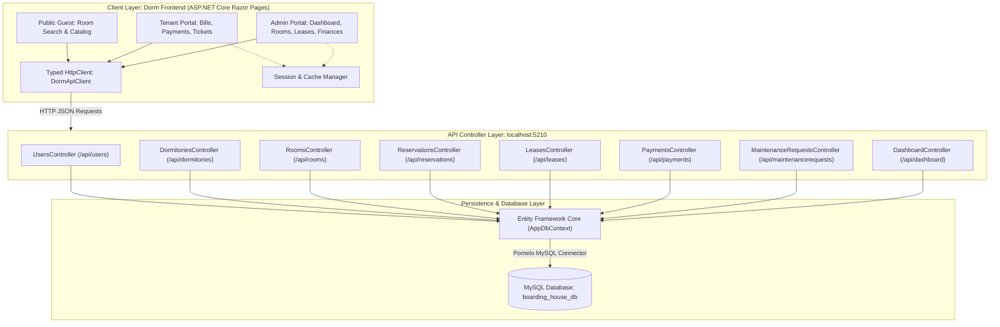
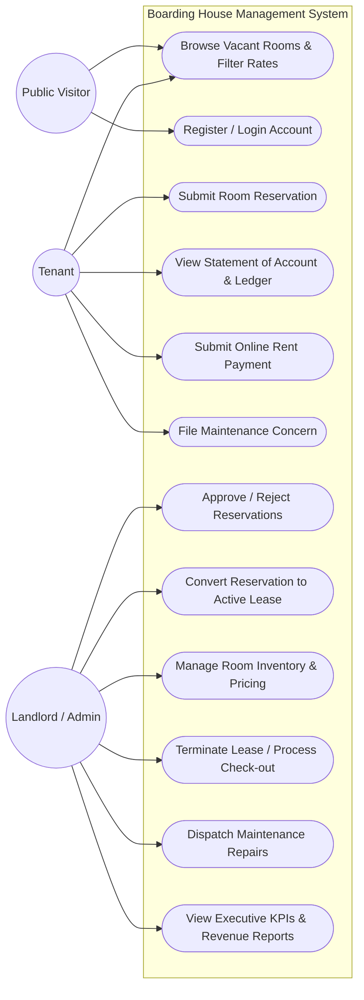
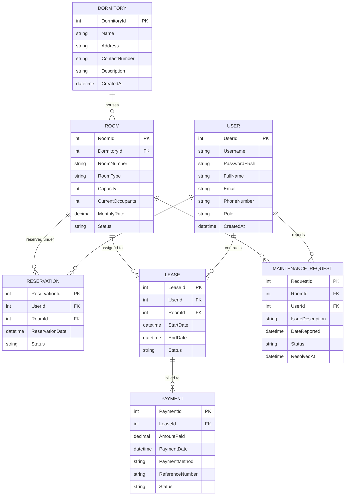
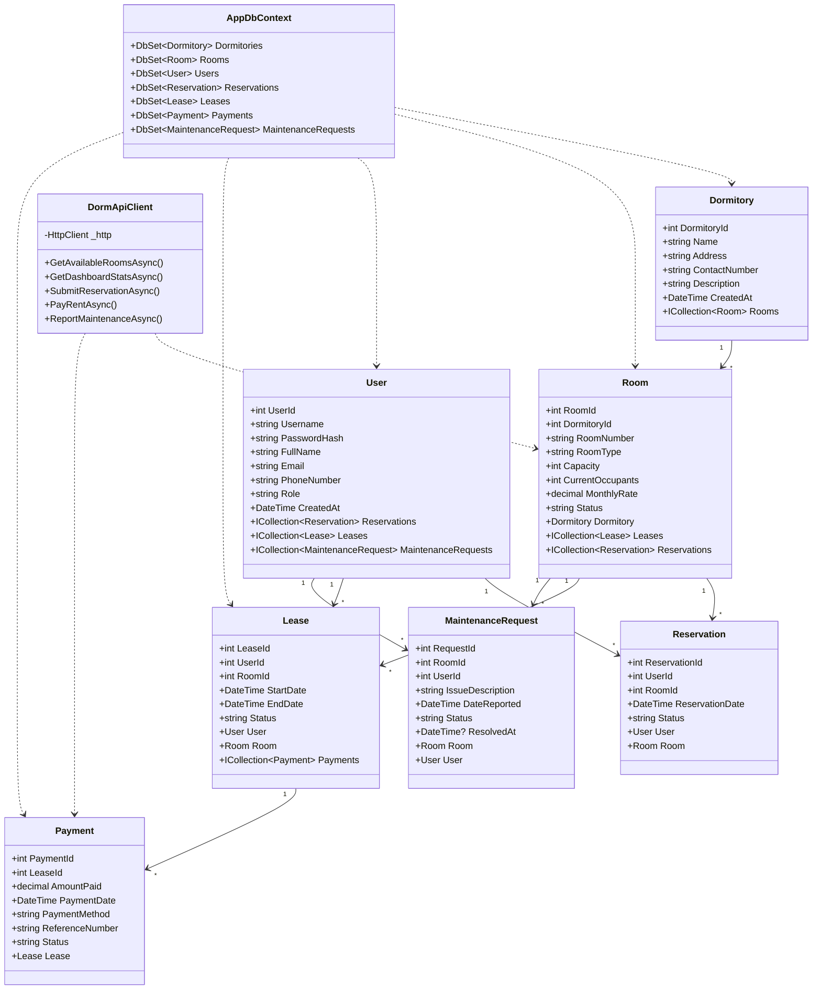
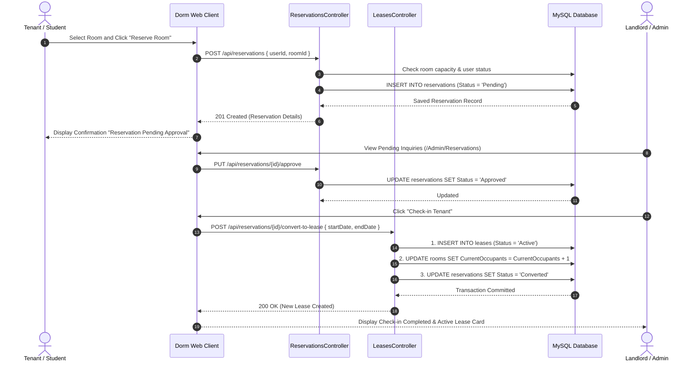
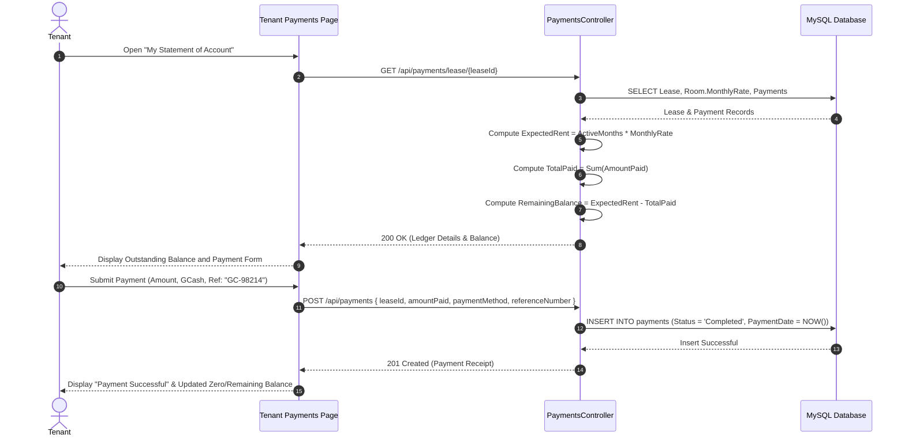
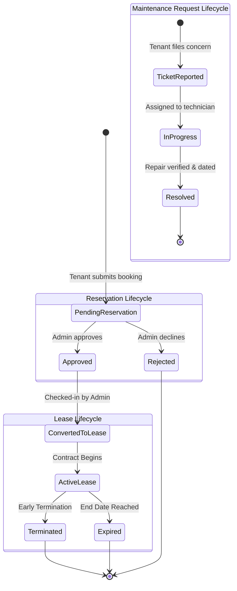

# Boarding House & Dormitory Management System (BHMS)

> **Masteral Project Technical Documentation**  
> A decoupled, enterprise-grade full-stack web application designed for boarding house landlords, dormitory operators, staff administrators, and tenants.

---

## 1. Project Title
**Boarding House & Dormitory Management System (BHMS)**  
*Full-Stack Accommodation Management, Reservation Lifecycle, Financial Accounting, and Tenant Portal*

---

## 2. Project Description
The **Boarding House & Dormitory Management System (BHMS)** is a comprehensive web-based management platform built to modernize and digitize the daily operations of student dormitories, private boarding houses, and rental residential facilities.

Traditional boarding house operations often rely on paper logbooks, manual spreadsheets, physical cash receipts, and unrecorded verbal maintenance requests. This leads to common operational friction such as double-booking rooms, inaccurate payment reconciliations, uncollected arrears, and delayed facility repairs.

BHMS solves these issues through a distributed client-server architecture:
- **Backend Service (`Boarding House Management System`):** A high-performance, stateless RESTful Web API built on **ASP.NET Core 8** and **Entity Framework Core**, backed by a **MySQL** relational database. It exposes endpoints for dormitories, rooms, reservations, leases, automated ledger calculation, payments, maintenance ticketing, and executive analytics.
- **Frontend Web Client (`DormitoryPage` / `Dorm`):** An intuitive, responsive web portal powered by **ASP.NET Core 8 Razor Pages**, utilizing a typed HTTP client (`DormApiClient`), session management, and asynchronous JavaScript (Fetch API) for dynamic interactions.

The platform provides role-tailored interfaces for **Visitors** (browsing available rooms), **Tenants** (managing leases, paying bills, filing maintenance concerns), and **Proprietors/Admins** (controlling room inventory, approving bookings, managing check-ins/check-outs, and tracking revenue).

---

## 3. Objectives

### General Objective
To develop, deploy, and evaluate a centralized, automated web management system that streamlines room administration, tenant onboarding, financial tracking, and maintenance resolution for boarding house and dormitory facilities.

### Specific Objectives
1. **Automate Inventory & Vacancy Tracking:** Provide real-time visibility into dormitory capacities, active occupant counts, and room availability to prevent overbooking.
2. **Streamline the Reservation & Lease Workflow:** Facilitate online reservation inquiries, administrative review/approvals, and seamless conversion of reservations into legal tenant leases.
3. **Ensure Financial Transparency & Automated Rent Accounting:** Automatically compute monthly rental liabilities based on lease duration, record multi-channel payments (Cash, GCash, Bank Transfer), track remaining balances, and generate electronic payment receipts.
4. **Digitize Maintenance & Incident Management:** Enable tenants to lodge maintenance tickets online with priority levels, allowing administrators to track repairs from "Pending" through "In Progress" to "Resolved" with completion timestamps.
5. **Provide Decision-Support Analytics:** Supply management with real-time key performance indicators (KPIs), including total revenue, collection rates, occupancy percentages, and pending operational tasks.
6. **Enforce Role-Based Security & Data Integrity:** Protect sensitive tenant data and financial records using PBKDF2/SHA-256 password hashing, role-based authorization (Admin, Landlord, Tenant), and strict relational database constraints.

---

## 4. Key Features

### 🏢 Public Visitor & Tenant Discovery
- **Search & Filter Engine:** Browse vacant rooms filtered by dormitory building, room type (Single, Double, Quad, Dormitory Hall), and maximum monthly rate.
- **Real-Time Room Availability:** Live capacity indicators showing current occupants versus total room capacity.
- **Detailed Room Profiles:** Inspect room amenities, rates, capacity, and building location before reserving.

### 📝 Reservation & Booking Management
- **Online Reservation Submission:** Registered tenants can submit booking inquiries for specific rooms with preferred dates.
- **Administrative Review Workflow:** Managers can accept, decline, or cancel reservation requests.
- **1-Click Lease Conversion:** Automatically convert approved reservations into active tenant leases while automatically incrementing room occupant counts.

### 🔑 Lease & Occupancy Lifecycle
- **Tenant Check-In & Check-Out:** Manage start and end dates with real-time status monitoring (`Active`, `Completed`, `Terminated`).
- **Overcapacity Protection:** Database-level and API-level safeguards prevent assigning tenants beyond room capacity limits.
- **Automated Occupancy Reversion:** Terminating or expiring a lease automatically decrements room occupancy and frees up vacancy.

### 💳 Financial Ledger & Rent Payments
- **Automated Balance Calculation:** The system calculates total expected rent (`Months Active × Monthly Rate`) and subtracts total payments to dynamically determine remaining balances.
- **Multi-Method Payment Recording:** Supports GCash, Bank Transfer, Cash, and Credit/Debit with transaction reference numbers.
- **Payment History & Receipts:** Full audit trail of payments with timestamps and status tracking (`Completed`, `Pending`, `Failed`).

### 🛠️ Maintenance & Repair Dispatcher
- **Ticket Submission:** Tenants report plumbing, electrical, carpentry, or HVAC issues directly against their assigned room.
- **Lifecycle Tracking:** Visual status badges (`Pending`, `In Progress`, `Resolved`) with technician completion timestamps.
- **Admin Dispatch Queue:** Centralized dashboard for staff to view and update maintenance priorities.

### 📊 Executive Dashboard & Analytics
- **Live KPI Counters:** Instant metrics on total rooms, active tenants, vacant slots, and pending reservations.
- **Occupancy Rate Meter:** Percentage-based visualization of current facility capacity.
- **Financial Analytics:** Total revenue collected, pending receivables, and monthly billing breakdown.

### 🔒 Security & User Management
- **Role-Based Access Control (RBAC):** Distinct roles for `Admin`, `Landlord`, and `Tenant`.
- **Cryptographic Password Hashing:** Salted PBKDF2 with SHA-256 algorithm.
- **Session-Based Authentication:** Secure HTTP-only cookies with configurable idle timeout.

---

## 5. Technology Stack

| Layer | Technology | Details / Packages |
| :--- | :--- | :--- |
| **Backend Framework** | **ASP.NET Core 8.0 Web API** | C# 12, RESTful Architecture |
| **ORM & Data Access** | **Entity Framework Core 8.0** | `Pomelo.EntityFrameworkCore.MySql` (v8.0.2) |
| **Database** | **MySQL 8.0 / MariaDB** | Database: `boarding_house_db` |
| **API Documentation** | **Swagger / OpenAPI** | `Swashbuckle.AspNetCore` (v6.6.2) |
| **Frontend Framework** | **ASP.NET Core 8.0 Razor Pages** | Server-rendered pages with MVVM pattern |
| **HTTP Client** | **Typed `HttpClient`** | `DormApiClient` with Base URL configuration |
| **UI Styling & Layout** | **HTML5, CSS3, Bootstrap 5** | Responsive layout, modern glassmorphism elements |
| **Client Scripting** | **JavaScript (ES6 Modules)** | Fetch API, asynchronous DOM updates |
| **State Management** | **ASP.NET Core Session & Cache** | `AddDistributedMemoryCache`, session cookies |
| **Security** | **PBKDF2 / SHA-256** | Custom `PasswordHasher` utility, CORS policy |

---

## 6. Project Structure

```text
c:/Masteral Projects/
├── Boarding House Management System/               # BACKEND REPOSITORY
│   ├── Boarding House Management System.sln
│   ├── Docs/
│   │   └── API_Design_Specification.md             # Complete API Specification
│   └── Boarding House Management System/
│       ├── Controllers/                            # RESTful API Controllers
│       │   ├── DashboardController.cs              # System KPIs & revenue analytics
│       │   ├── DormitoriesController.cs            # Dorm building CRUD
│       │   ├── LeasesController.cs                 # Lease contracts & occupancy
│       │   ├── MaintenanceRequestsController.cs    # Repair ticket management
│       │   ├── PaymentsController.cs               # Billing & payment ledger
│       │   ├── ReservationsController.cs           # Booking & lease conversion
│       │   ├── RoomsController.cs                  # Room availability & filters
│       │   ├── SeedController.cs                   # Database re-seed endpoint
│       │   └── UsersController.cs                  # Authentication & user CRUD
│       ├── Data/
│       │   └── AppDbContext.cs                     # EF Core DbContext & relationships
│       ├── DTOs/                                   # Data Transfer Objects
│       ├── Migrations/                             # EF Core database migrations
│       ├── Model/                                  # Domain Entities
│       │   ├── Dormitory.cs
│       │   ├── Lease.cs
│       │   ├── MaintenanceRequest.cs
│       │   ├── Payment.cs
│       │   ├── Reservation.cs
│       │   ├── Room.cs
│       │   └── User.cs
│       ├── Services/                               # Business logic & seeders
│       │   ├── DbSeeder.cs                         # Mock dataset initializer
│       │   └── PasswordHasher.cs                   # PBKDF2/SHA-256 security helper
│       ├── appsettings.json                        # Connection string & logging
│       └── Program.cs                              # Web host, CORS, DI, Swagger
│
└── DormitoryPage/                                  # FRONTEND REPOSITORY
    └── Dorm/
        ├── Dorm.sln
        ├── Docs/
        │   └── API_Design_Specification.md
        └── Dorm/
            ├── Models/
            │   └── ApiModels.cs                    # Client-side ViewModels & DTOs
            ├── Pages/                              # Razor Pages (UI & PageModels)
            │   ├── Account/                        # Auth Pages (Login, Register)
            │   ├── Admin/                          # Landlord/Admin Management Portal
            │   │   ├── Dashboard.cshtml / .cs      # Executive summary
            │   │   ├── Financials.cshtml / .cs     # Revenue & payments table
            │   │   ├── Leases.cshtml / .cs         # Active contracts & check-in
            │   │   ├── Reservations.cshtml / .cs   # Booking inquiry approval
            │   │   └── Rooms.cshtml / .cs          # Room inventory management
            │   ├── Rooms/                          # Room details & reservation form
            │   ├── Tenant/                         # Tenant Self-Service Portal
            │   │   ├── Dashboard.cshtml / .cs      # Tenant home & lease status
            │   │   ├── Maintenance.cshtml / .cs    # Ticket submission & history
            │   │   └── Payments.cshtml / .cs       # Statement of account & pay rent
            │   ├── Index.cshtml / .cs              # Public landing & room search
            │   ├── Error.cshtml / .cs              # Error boundary page
            │   └── Shared/                         # Layouts, navbars, partials
            ├── Services/
            │   ├── DormApiClient.cs                # Typed HTTP API client
            │   └── SessionService.cs               # Tenant session manager
            ├── wwwroot/                            # Static assets (CSS, JS, Images)
            ├── appsettings.json                    # API Base URL config
            └── Program.cs                          # Razor Pages host & session setup
```

---

## 7. Setup & Execution Instructions

### Prerequisites
Before running the projects, ensure you have installed:
1. **.NET 8.0 SDK** ([Download .NET 8.0](https://dotnet.microsoft.com/download/dotnet/8.0))
2. **MySQL Server 8.0+** (or MySQL via XAMPP / MariaDB)
3. **Visual Studio 2022** (with ASP.NET and web development workload) or **Visual Studio Code**
4. Optional: **MySQL Workbench** or **phpMyAdmin** for database inspection

---

### Step 1: Database Setup
1. Start your local MySQL service (Default port: `3306`).
2. Create an empty database named `boarding_house_db` using your MySQL client:
   ```sql
   CREATE DATABASE IF NOT EXISTS boarding_house_db CHARACTER SET utf8mb4 COLLATE utf8mb4_unicode_ci;
   ```
3. Verify the connection string in backend `Boarding House Management System/Boarding House Management System/appsettings.json`:
   ```json
   {
     "ConnectionStrings": {
       "DefaultConnection": "Server=localhost;Port=3306;Database=boarding_house_db;User=root;Password=YOUR_MYSQL_PASSWORD;"
     }
   }
   ```
   *(Update `Password` and `User` with your local credentials).*

---

### Step 2: Running the Backend API
1. Open terminal and navigate to the API project folder:
   ```powershell
   cd "c:\Masteral Projects\Boarding House Management System\Boarding House Management System"
   ```
2. Restore dependencies and run the project:
   ```powershell
   dotnet restore
   dotnet run
   ```
3. The API will start on:
   - **Base URL:** `http://localhost:5210`
   - **Swagger UI:** `http://localhost:5210/swagger`
4. **Automatic Seeding:** Upon first run, `DbSeeder.cs` automatically populates dormitories, rooms, users, reservations, leases, payments, and maintenance requests if the database is empty.

---

### Step 3: Running the Frontend Razor Pages
1. Open a second terminal window and navigate to the frontend project:
   ```powershell
   cd "c:\Masteral Projects\DormitoryPage\Dorm\Dorm"
   ```
2. Verify that `appsettings.json` points to the active API address:
   ```json
   {
     "ApiSettings": {
       "BaseUrl": "http://localhost:5210/api"
     }
   }
   ```
3. Restore dependencies and run the frontend:
   ```powershell
   dotnet restore
   dotnet run
   ```
4. Access the web application in your browser:
   - **Public Portal:** `http://localhost:5000` or the port shown in terminal (e.g., `https://localhost:7123`)

---

### Demo User Accounts

| Role | Username | Password | Purpose |
| :--- | :--- | :--- | :--- |
| **Admin / Landlord** | `admin` | `admin123` | Full administrative access to rooms, leases, reservations, financials, and dashboard |
| **Tenant** | `john_doe` | `tenant123` | Active tenant with lease, payments ledger, and maintenance reporting |
| **Tenant** | `jane_smith` | `tenant123` | Active tenant account |
| **Landlord** | `landlord1` | `landlord123` | Property proprietor account |

---

## 8. UML Diagrams

### 8.1 System Architecture Diagram


---

### 8.2 Use Case Diagram


---

### 8.3 Entity-Relationship Diagram (ERD)


---

### 8.4 Class Diagram


---

### 8.5 Sequence Diagram: Reservation to Lease Check-in Flow


---

### 8.6 Sequence Diagram: Rent Billing & Payment Flow


---

### 8.7 State Machine Diagram: Lease & Maintenance Lifecycles


---

## 9. License & Academic Attribution
Developed as a Masteral Project capstone in software architecture, distributed web systems, and database engineering.  
Designed for educational and commercial facility management deployment.
